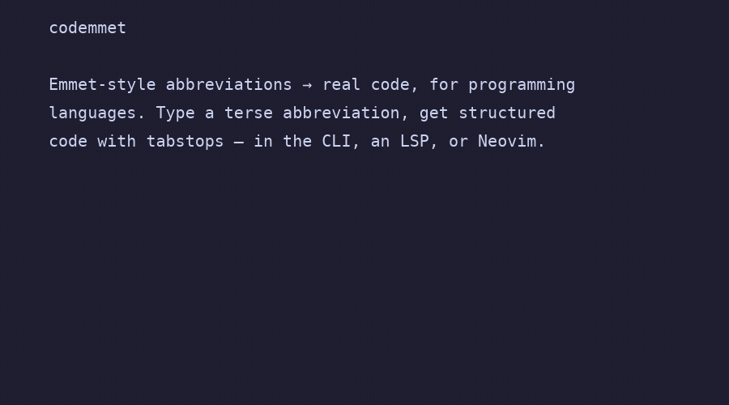

# codemmet

Emmet-style abbreviation expansion for programming languages.

<p align="center">
  
</p>

Type a terse abbreviation, get structured code with tabstops:

```
fn:main>fori10>pr        (in a Rust buffer)
```

```rust
fn main() {
    for i in 0..10 {
        println!("");
    }
}
```

Delivered as one binary that is both a CLI (`codemmet expand`, `wrap`, `list`,
`check`) and an LSP server (`codemmet lsp`), plus a Neovim plugin in this repo.
It uses tree-sitter for context-aware expansion (e.g. `fn` inside an `impl`
block gains `&self`) and wrap-with-abbreviation.

## Try it in your browser

Two pages run the real engine compiled to WebAssembly, no install needed:

- The [**playground**](https://thewyliestcoyote.github.io/codemmit/) — pick a
  language, type an abbreviation, watch it expand.
- The [**trainer**](https://thewyliestcoyote.github.io/codemmit/train.html) —
  `codemmet train` in the browser: guided lessons, drills, and spaced
  repetition (progress saved in `localStorage`).

(Build them locally with `just playground-serve`; deploy with the included
[Pages workflow](.github/workflows/playground.yml). See
[playground/](playground/README.md).)

## Install

**Prebuilt binaries.** Each [tagged release](https://github.com/TheWylieStCoyote/codemmit/releases)
ships a `codemmet` binary for Linux, macOS (Intel and Apple Silicon), and
Windows. Download the archive for your platform, extract it, and put `codemmet`
on your `PATH`.

**From source** (needs a Rust toolchain, and a C compiler for the bundled
tree-sitter grammars):

```sh
cargo install --git https://github.com/TheWylieStCoyote/codemmit codemmet
```

Or clone and `cargo install --path crates/codemmet`. For a smaller build with
no C toolchain (text-only, no tree-sitter context), add
`--no-default-features`. See [installation](docs/installation.md) for the full
details and how to verify the install.

## Documentation

Full guides live in **[docs/](docs/README.md)** — start with
[installation](docs/installation.md), then the [tutorials](docs/tutorials.md)
and [editor setup](docs/editors.md). Reference: [abbreviation
syntax](docs/syntax.md), [language reference](docs/languages.md), [CLI
reference](docs/cli.md), [custom snippets](docs/snippets.md), and
[troubleshooting](docs/troubleshooting.md).

**Status: all planned milestones complete**, including data-driven expansion.
Supported languages: Rust, Python, C, C++ (inherits C), JavaScript, TypeScript
(inherits JavaScript), and Go — ~265 builtin triggers. Tree-sitter powers
context-aware expansion (`fn` inside an `impl` block expands with `&self`,
`def` in a Python class gets `self`), data-driven repeats that read enum
variants and struct fields from the buffer (`match:Msg>arm*`), completion
suppression inside strings and comments, and statement-boundary snapping for
wrap selections. See [PLAN.md](PLAN.md) and
[context-aware & data-driven expansion](docs/context-codegen.md) for the
design.

## Neovim

Install with lazy.nvim (builds the binary on install):

```lua
{
  "TheWylieStCoyote/codemmit",
  build = "cargo build --release",
  ft = {
    "rust", "python", "c", "cpp",
    "javascript", "javascriptreact", "typescript", "typescriptreact",
    "go",
  },
  opts = {
    cmd = { "codemmet", "lsp" },              -- or the target/release path
    keymaps = { expand = "<A-e>", wrap = "<leader>cw" },
  },
}
```

Abbreviations appear as snippet completions in any completion setup
(nvim-cmp, blink.cmp, built-in). `<A-e>` expands the abbreviation before
the cursor explicitly; select lines and `<leader>cw` wraps them in a
construct (`fori10`, `if`, `try`, …). `:CodemmetExpand` and
`:CodemmetWrap` are the command equivalents. Requires Neovim ≥ 0.10.

Any other LSP-capable editor works too: point it at `codemmet lsp` and
wire `codemmet.expand` / `codemmet.wrap` to keybindings.

## CLI

```sh
codemmet expand --lang rust "fn:main>fori10>prf:\"i={}\",i"
codemmet expand --lang python --tabstops keep "def:handler>try"
echo "class:Point>init" | codemmet expand --lang py -
codemmet list --lang rust          # all triggers with descriptions
codemmet check                     # validate user snippet overrides
```

`--tabstops keep` emits LSP snippet syntax (`${1:placeholder}`, `$0`);
the default `strip` emits plain text (`--json` adds the cursor position).
User overrides live in `~/.config/codemmet/snippets/<lang>.toml` and can
override or `disabled = true` any builtin trigger.

## Abbreviation syntax at a glance

| Operator | Meaning              | Example                  |
| -------- | -------------------- | ------------------------ |
| `word`   | trigger + glued args | `fori10`                 |
| `:`, `,` | explicit args        | `fn:main`, `use:"std::fmt"` |
| `>`      | nest as child        | `fn:main>fori10`         |
| `+`      | sibling statement    | `if+el`                  |
| `*`      | repeat               | `match:x>arm*3`          |
| `()`     | group                | `(fori10>pr)+ret`        |
| `^`      | climb up a level     | `fn:main>fori10>pr^ret`  |

## Development

Requires stable Rust (edition 2024). Optional tools: [`just`](https://github.com/casey/just),
[`lefthook`](https://github.com/evilmartians/lefthook), [`stylua`](https://github.com/JohnnyMorganz/StyLua),
[`cargo-deny`](https://github.com/EmbarkStudios/cargo-deny), [`cargo-insta`](https://insta.rs).

```sh
lefthook install   # once per clone: fmt on commit, clippy+tests on push
just lint          # what CI enforces
just test
just ci            # the full CI suite locally
```

Workspace layout:

- `crates/codemmet-core` — abbreviation parser, snippet IR, renderer, TOML
  snippet loader. No tree-sitter, no async, no CLI deps.
- `crates/codemmet-tsctx` — tree-sitter `ContextProvider` (phases M3/M4).
- `crates/codemmet` — the `codemmet` binary: CLI + LSP server.
- `lua/`, `plugin/` — Neovim plugin (phase M2).

## License

MIT or Apache-2.0, at your option.
