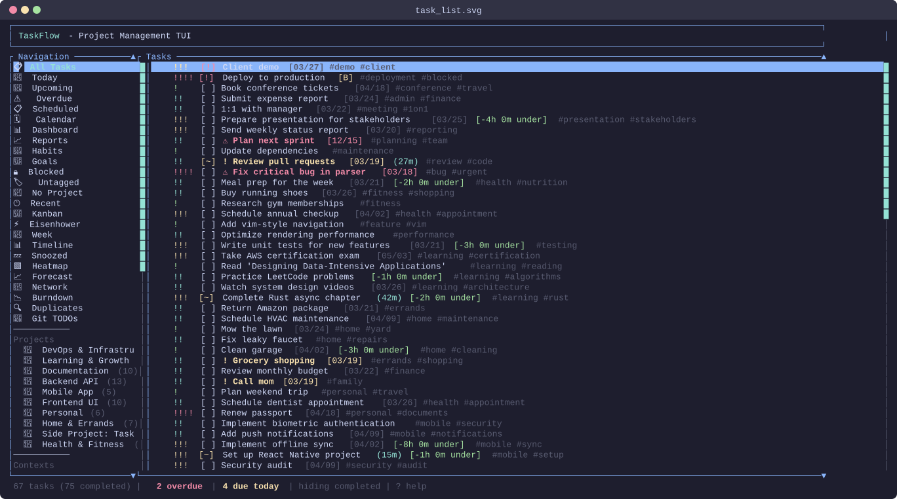
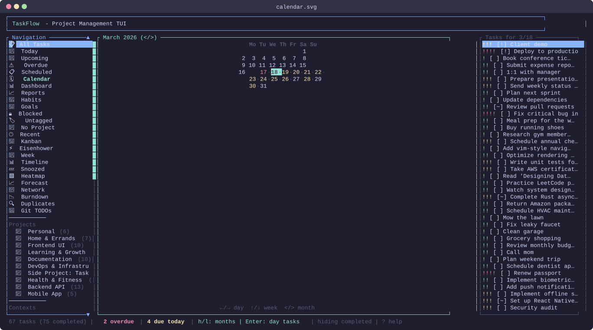
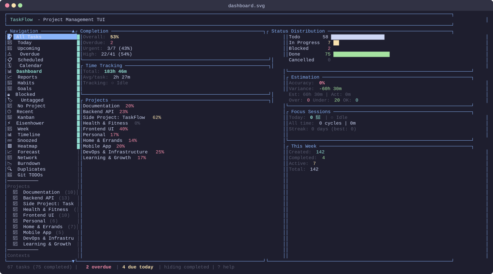
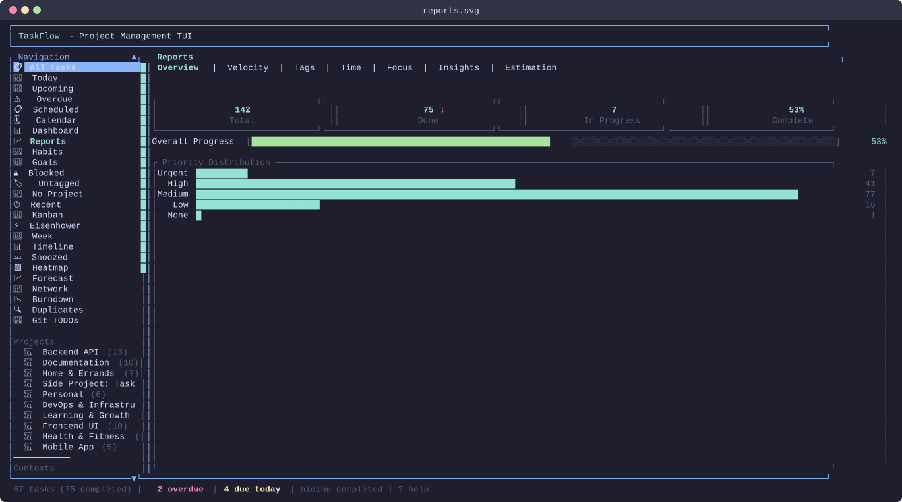

# TaskFlow User Manual

A comprehensive guide to TaskFlow, your terminal-based task management application.

---

## Table of Contents

1. [Introduction](#1-introduction)
2. [Getting Started](#2-getting-started)
3. [The Interface](#3-the-interface)
4. [Task Management](#4-task-management)
5. [Organization](#5-organization)
6. [Views & Filtering](#6-views--filtering)
7. [Time Management](#7-time-management)
8. [Analytics & Reports](#8-analytics--reports)
9. [Data Management](#9-data-management)
10. [Customization](#10-customization)
11. [Advanced Features](#11-advanced-features)
12. [Appendices](#appendices)

---

## 1. Introduction

### What is TaskFlow?

TaskFlow is a powerful, keyboard-driven task management application that runs entirely in your terminal. Inspired by tools like Taskwarrior and Todoist, TaskFlow combines the speed of a CLI with the visual clarity of a TUI (Terminal User Interface).

Whether you're managing personal todos, tracking work projects, or organizing complex workflows with dependencies, TaskFlow provides the features you need without ever leaving your terminal.

### Key Features

- **Fast keyboard navigation** - Vim-style keybindings for efficient task management
- **Project organization** - Group tasks into projects with sidebar navigation
- **Flexible tagging** - Categorize tasks with tags and filter dynamically
- **Time tracking** - Built-in timer with start/stop and detailed logging
- **Pomodoro technique** - Integrated focus timer with work/break cycles
- **Multiple views** - Today, Upcoming, Calendar, Dashboard, and more
- **Task dependencies** - Block tasks until prerequisites are complete
- **Recurring tasks** - Daily, weekly, monthly, or yearly repetition
- **Subtasks** - Break down complex tasks into hierarchies
- **Undo/redo** - Safely experiment with full history support
- **Multiple backends** - Store data as JSON, YAML, SQLite, or Markdown
- **Customizable** - Themes, keybindings, and settings via config files
- **Import/Export** - CSV and iCalendar format support
- **Scripting** - `taskflow pipe` JSON interface (JSON/YAML/CSV output) plus `add`, `list`, `done`, `time` and more from the shell

### System Requirements

- **Operating System**: Linux, macOS, or Windows (with a terminal supporting ANSI colors)
- **Terminal**: Any modern terminal with UTF-8 support
- **Rust**: Version 1.87+ (for building from source)

---

## 2. Getting Started

### Installation

#### Building from Source

```bash
# Clone the repository
git clone <repository-url>
cd taskflow

# Build the release version
cargo build --release

# The binary is at ./target/release/taskflow
# Optionally, copy it to your PATH:
sudo cp ./target/release/taskflow /usr/local/bin/
```

#### Verify Installation

```bash
taskflow --version
```

### First Launch

Run TaskFlow with default settings:

```bash
taskflow
```

On first launch, TaskFlow creates a data file in the default location (`~/.local/share/taskflow/tasks.json`) and displays an empty task list.

#### Launch with Demo Data

To explore TaskFlow with sample tasks:

```bash
taskflow --demo
```

This loads example projects, tasks, and time entries so you can immediately try the interface.

### Basic Concepts

Before diving in, understand these core concepts:

#### Tasks

The fundamental unit in TaskFlow. Each task has:
- **Title** - What needs to be done
- **Status** - Todo, In Progress, Blocked, Done, or Cancelled
- **Priority** - None, Low, Medium, High, or Urgent
- **Due date** - When it should be completed (optional)
- **Tags** - Labels for categorization (optional)
- **Description** - Additional notes (optional)

#### Projects

Containers for related tasks. Projects help you:
- Group tasks by area (Work, Personal, Home)
- Filter to see only relevant tasks
- Track progress across related items

#### Tags

Flexible labels that cut across projects:
- A task can have multiple tags
- Filter by one or more tags
- Examples: `#bug`, `#meeting`, `#research`, `#urgent`

### Quick Tutorial (5 Minutes)

Let's create your first task and explore the basics.

**Step 1: Create a Task**
1. Press `a` to add a new task
2. Type: `Buy groceries #errands due:tomorrow`
3. Press `Enter`

You've created a task with a tag and due date using Quick Add syntax!

**Step 2: Navigate**
- Press `j` to move down (or `↓`)
- Press `k` to move up (or `↑`)
- Press `g` to jump to the first task
- Press `G` to jump to the last task

**Step 3: Complete a Task**
- Select a task and press `x` or `Space` to mark it complete

**Step 4: Change Priority**
- Press `p` to cycle through priority levels
- Watch the `!` indicators change on the left

**Step 5: Create a Project**
1. Press `P` to create a project
2. Type a project name (e.g., "Home")
3. Press `Enter`

**Step 6: Assign to Project**
1. Select a task
2. Press `m` to move it
3. Select your project and press `Enter`

**Step 7: Explore Views**
1. Press `h` to focus the sidebar
2. Use `j`/`k` to navigate between views
3. Press `Enter` to select a view

**Step 8: Get Help**
- Press `?` to show the help popup with all keybindings
- Press `?` again or `Esc` to close it

**Step 9: Quit**
- Press `q` to exit TaskFlow
- Your data is saved automatically!

Congratulations! You've learned the basics. Continue reading for in-depth coverage of every feature.

---

## 3. The Interface

### Layout Overview

TaskFlow's interface is divided into distinct areas:

```
┌─────────────────────────────────────────────────────────────────┐
│ TaskFlow                                                        │ ← Header
├──────────────┬──────────────────────────────────────────────────┤
│              │                                                  │
│   Sidebar    │              Task List                           │
│              │                                                  │
│  ┌─────────┐ │  ┌─────────────────────────────────────────────┐ │
│  │ Views   │ │  │ !!!! [ ] Fix critical bug        due:today  │ │
│  │ ─────── │ │  │ !!!  [~] Implement feature       #backend   │ │
│  │ All     │ │  │ !!   [ ] Write tests             #testing   │ │
│  │ Today   │ │  │ !    [ ] Update documentation               │ │
│  │ Upcoming│ │  │      [x] Initial setup           completed  │ │
│  │ Overdue │ │  └─────────────────────────────────────────────┘ │
│  │ Calendar│ │                                                  │
│  │         │ │                                                  │
│  │ Projects│ │                                                  │
│  │ ─────── │ │                                                  │
│  │ Work    │ │                                                  │
│  │ Personal│ │                                                  │
│  └─────────┘ │                                                  │
├──────────────┴──────────────────────────────────────────────────┤
│ 5 tasks (1 completed) │ showing all │ ? for help               │ ← Footer
└─────────────────────────────────────────────────────────────────┘
```



### Header

The top bar displays:
- Application name ("TaskFlow")
- Current view or search query
- Active Pomodoro timer (when running)

### Sidebar

The left panel contains:

**Views Section** (in sidebar order)
- All Tasks - Every task regardless of status
- Today - Tasks due today
- Upcoming - Tasks with future due dates
- Overdue - Tasks past their due date
- Scheduled - Tasks with scheduled dates
- Calendar - Monthly calendar view
- Dashboard - Statistics overview
- Reports - Detailed analytics
- Habits - Habit tracker
- Goals - OKR goals and key results
- Blocked - Tasks waiting on dependencies
- Untagged - Tasks without tags
- No Project - Unassigned tasks
- Recent - Tasks modified in the last 7 days
- Kanban, Eisenhower, Weekly Planner, Timeline - Board, matrix, week and Gantt layouts
- Snoozed - Tasks hidden until their snooze date
- Heatmap, Forecast, Network, Burndown - Completion heatmap, workload forecast, dependency graph, burndown chart
- Duplicates - Likely duplicate task pairs
- Git TODOs - Tasks extracted from code comments

There are no number-key shortcuts for views; use the sidebar (`h`, `j`/`k`, `Enter`) or `Alt+g` for Git TODOs.

**Projects Section**
- Lists all your projects
- Shows task count per project
- Selecting a project filters the task list

### Task List

The main content area showing tasks with:

```
Priority  Status  Title                      Tags         Due Date
   │        │       │                          │              │
   ▼        ▼       ▼                          ▼              ▼
  !!!!    [ ]    Fix critical bug           #urgent        [12/15]
```

**Priority Indicators** (leftmost):
| Symbol | Level |
|--------|-------|
| `!!!!` | Urgent |
| `!!!` | High |
| `!!` | Medium |
| `!` | Low |
| (blank) | None |

**Status Symbols**:
| Symbol | Status |
|--------|--------|
| `[ ]` | Todo |
| `[~]` | In Progress |
| `[!]` | Blocked |
| `[x]` | Done |
| `[-]` | Cancelled |

**Additional Indicators**:
- `↻` - Recurring task
- `[B]` - Has blocking dependencies
- `▶` - Has subtasks
- `●` (red) - Time is being tracked; the footer shows the running `⏱` timer

### Footer / Status Bar

The bottom bar shows:
- Task count: "5 tasks (1 completed)"
- Filter state: "showing all" or current filter
- Mode indicators: Search, Multi-select, etc.
- Help reminder: "? for help"
- Pomodoro status when active

### Modal Dialogs

TaskFlow uses popups for:
- **Input dialogs** - Creating/editing tasks, setting dates
- **Confirmation dialogs** - Delete confirmation
- **Help popup** - Keybinding reference
- **Template picker** - Quick task creation
- **Time log editor** - Managing time entries

Press `Esc` to close any dialog without saving. `Esc` also leaves focus mode and, in every view, returns focus to the sidebar so you can pick another view with `j`/`k` and `Enter`; `l` or `→` goes back into the view. `Esc` never quits TaskFlow (use `q`).

---

## 4. Task Management

### Creating Tasks

#### Basic Creation

1. Press `a` to open the task input
2. Type your task title
3. Press `Enter` to create

#### Quick Add Syntax

Create tasks with metadata in a single line:

```
Buy groceries #errands !high due:tomorrow @Personal
```

| Syntax | Meaning | Example |
|--------|---------|---------|
| `#tag` | Add a tag | `#work`, `#bug` |
| `!priority` | Set priority | `!urgent`, `!high`, `!med`, `!low` |
| `due:date` | Set due date | `due:tomorrow`, `due:2025-01-15` |
| `sched:date` | Set scheduled date | `sched:monday` |
| `@project` | Assign to project | `@Work`, `@Personal` |

**Date Keywords:**
- `today`, `tod` - Today's date
- `tomorrow`, `tom` - Tomorrow
- `monday`, `mon`, `tuesday`, `tue`, etc. - Next occurrence of weekday
- `next week` - Same day next week
- `next month` - Same day next month
- `in 3 days` - Three days from now
- `in 2 weeks` - Two weeks from now
- `eow` - End of week (Sunday)
- `eom` - End of month
- `eoy` - End of year
- `1st`, `15th`, `22nd` - Day of current month
- `YYYY-MM-DD` - Specific date (ISO format)

**Examples:**
```
Fix login bug #bug !urgent due:today @Backend
Write report due:friday #work
Call dentist sched:next monday @Personal
Review PR #code-review !high due:in 2 days
```

### Editing Tasks

#### Edit Title
1. Select a task
2. Press `e`
3. Modify the title
4. Press `Enter` to save or `Esc` to cancel

#### Edit Due Date
1. Select a task
2. Press `D`
3. Enter date (YYYY-MM-DD format or keywords)
4. Press `Enter` or leave blank to clear

#### Edit Tags
1. Select a task
2. Press `T`
3. Enter comma-separated tags: `work, urgent, meeting`
4. Press `Enter` (empty clears tags)

#### Edit Description
1. Select a task
2. Press `n`
3. Type or modify the description
4. Press `Enter` to save

### Task Properties

#### Priority

Cycle priority with `p`:
```
None → Low → Medium → High → Urgent → None
```

Priority affects:
- Visual indicator (! symbols)
- Sort order when sorting by priority
- Dashboard statistics

#### Status

The task status lifecycle:

```
       ┌─────────────────────┐
       │                     │
       ▼                     │
    ┌──────┐   toggle    ┌───────┐
    │ Todo │────────────▶│ Done  │
    └──────┘             └───────┘
       │                     ▲
       │ (manual)            │ (manual)
       ▼                     │
  ┌────────────┐    ┌────────────┐
  │In Progress │    │ Cancelled  │
  └────────────┘    └────────────┘
       │
       │ (manual)
       ▼
   ┌─────────┐
   │ Blocked │
   └─────────┘
```

- Press `x` or `Space` to toggle between Todo ↔ Done
- Other statuses can be set via editing

### Completing Tasks

#### Single Task
- Select the task and press `x` or `Space`
- The task moves to "Done" status
- If hiding completed, it disappears from view

#### Recurring Tasks
When you complete a recurring task:
1. The current task is marked Done
2. A new task is created with the next due date
3. The new task appears in your list

### Deleting Tasks

1. Select the task
2. Press `d`
3. Confirm deletion in the popup

**Note**: Deletion is permanent but can be undone with `u` or `Ctrl+z`.

**Deletion Restrictions**:
- Tasks with subtasks cannot be deleted directly
- Delete subtasks first, then the parent

### Multi-Select & Bulk Operations

For operations on multiple tasks:

1. Press `v` to enter multi-select mode
2. Navigate and press `Space` to toggle selection on each task
3. Selected tasks show a `●` indicator
4. Perform bulk operations on every selected task:
   - `p` - Set priority
   - `T` - Add tags
   - `D` - Set due date
   - `z` - Snooze until a date
5. Press `v` or `Ctrl+v` to exit multi-select

Bulk delete, bulk move-to-project and bulk set-status exist as actions but have no default key: run them from the command palette (`:`) or bind keys in the keybindings editor (`Ctrl+k`). While in multi-select mode, `d`, `m` and `x` still act on the highlighted task only.

**Quick Select All:**
- Press `V` to select all visible tasks at once

### Task Templates

Create tasks quickly from predefined templates:

1. Press `Ctrl+n` to open template picker
2. Navigate with `j`/`k` or press the template number
3. Press `Enter` to create from template
4. Edit the generated task title as needed

**Built-in Templates:**
| Template | Priority | Tags | Due |
|----------|----------|------|-----|
| Bug Fix | High | #bug | - |
| Feature | Medium | #feature | - |
| Review | Medium | #review | Tomorrow |
| Meeting Notes | Low | #meeting | - |
| Daily Task | Low | - | Today |
| Weekly Task | Low | - | +7 days |
| Urgent | Urgent | - | Today |
| Research | Low | #research | - |

Bug Fix, Feature, Meeting Notes and Research also pre-fill a structured description. You can add your own templates under `[[custom_templates]]` in `config.toml` (see [Customization](#10-customization)).

---

## 5. Organization

### Projects

Projects group related tasks and appear in the sidebar.

#### Create a Project
1. Press `P`
2. Enter the project name
3. Press `Enter`

#### Edit a Project
1. Focus the sidebar (`h`)
2. Select the project
3. Press `E`
4. Modify the name
5. Press `Enter`

#### Delete a Project
1. Focus the sidebar (`h`)
2. Select the project
3. Press `X`
4. Confirm deletion

**Note**: Deleting a project unassigns its tasks (tasks are not deleted).

#### Project Status
Projects have their own lifecycle:
- **Active** - Currently being worked on
- **On Hold** - Temporarily paused
- **Completed** - All work finished
- **Archived** - No longer relevant

#### Assign Task to Project
1. Select a task
2. Press `m` (move)
3. Choose the destination project
4. Press `Enter`

### Tags

Tags are flexible labels for cross-cutting concerns.

#### Add Tags to a Task
1. Select the task
2. Press `T`
3. Enter comma-separated tags: `work, urgent, q4`
4. Press `Enter`

#### Quick Add with Tags
```
New feature #frontend #priority
```

#### Filter by Tags
1. Press `#`
2. Enter tag(s) to filter by
3. Press `Enter`

Tasks matching any of the tags are shown.

#### Clear Tag Filter
Press `Ctrl+t` to remove the tag filter.

### Subtasks & Hierarchies

Break complex tasks into smaller pieces:

#### Create a Subtask
1. Select the parent task
2. Press `A` (capital A)
3. Enter the subtask title
4. Press `Enter`

The subtask appears indented under its parent.

#### Hierarchy Display
```
▶ [ ] Main project task
    [ ] Subtask 1
    [ ] Subtask 2
        [ ] Sub-subtask
```

#### Completing Parent Tasks
When you complete a parent task:
- All subtasks are also marked complete
- This cascades down the entire hierarchy

When you uncomplete a parent:
- Only the parent changes
- Subtasks remain in their current state

### Task Dependencies

Block a task until others are complete:

#### Set Dependencies
1. Select the task to block
2. Press `B`
3. Enter the list numbers of the blocking tasks as shown in the current task list (e.g. `2, 5`; any non-digit separator works)
4. Press `Enter` (an empty entry clears the dependencies; a task cannot depend on itself)

Blocked tasks show `[!]` status and cannot be completed until blockers are done.

#### View Blocked Tasks
Select "Blocked" from the sidebar to see all blocked tasks.

### Task Chains

Link tasks in sequence for workflows:

#### Create a Chain
1. Select a task
2. Press `Alt+l` to link to next task
3. Select the task that should follow
4. Press `Enter`

Chains visualize work sequences and can be exported as diagrams.

#### Unlink from Chain
1. Select a chained task
2. Press `Alt+u` to unlink

### Recurring Tasks

Set up tasks that repeat automatically:

#### Configure Recurrence
1. Select a task
2. Press `R`
3. Enter a pattern:
   - `d` - Daily (`d3` = every 3 days)
   - `w` - Weekly (`w2` = every 2 weeks)
   - `m` - Monthly on today's day of month (`m15` = on the 15th)
   - `y` - Yearly (same date)
   - `0` or `n` - Clear recurrence
   - Optionally append `end=YYYY-MM-DD` and/or `max=N` to stop after a date or a number of occurrences, e.g. `w2 end=2026-12-31`

Recurring tasks show `↻` indicator.

#### How Recurrence Works
1. You complete a recurring task
2. TaskFlow creates a new task automatically
3. The new task has the next due date based on the pattern
4. Original task stays in completed state

---

## 6. Views & Filtering

### Available Views

Access views from the sidebar (`h` to focus, `j`/`k` to navigate, `Enter` to select):

| View | Shows |
|------|-------|
| All Tasks | Every task in the system |
| Today | Tasks due today |
| Upcoming | Tasks with future due dates |
| Overdue | Tasks past their due date |
| Calendar | Monthly calendar with tasks |
| Dashboard | Statistics and overview |
| Reports | Detailed analytics |
| Scheduled | Tasks with scheduled dates |
| Blocked | Tasks waiting on dependencies |
| Untagged | Tasks without any tags |
| No Project | Tasks not assigned to a project |
| Recent | Tasks modified in last 7 days |
| Habits / Goals | Habit tracker; OKR goals with key results |
| Kanban / Eisenhower / Weekly Planner / Timeline | Board by status; urgent/important matrix; day columns; Gantt-style bars |
| Snoozed | Tasks hidden until their snooze date |
| Heatmap / Forecast / Network / Burndown | Completion heatmap; workload projection; dependency graph; burndown chart (`w` window, `o` mode, `+` scope creep) |
| Duplicates | Likely duplicate pairs (`D` dismiss, `M` merge, `r` refresh) |
| Git TODOs | Tasks extracted from code comments (`r` rescans) |

In every view `Esc` returns focus to the sidebar, where `j`/`k` and `Enter` pick another view and `l` or `→` returns to the main pane. While the main pane has focus, `Enter` opens the selected task; in the Kanban, Eisenhower, Weekly Planner, Timeline, Network and Goals views `h`/`l` navigate inside the view, so `Esc` is the way back to the sidebar there.

### Calendar View

The calendar provides a monthly overview:

```
┌─────────────────────────────────────────┐
│           December 2025                 │
├─────┬─────┬─────┬─────┬─────┬─────┬─────┤
│ Sun │ Mon │ Tue │ Wed │ Thu │ Fri │ Sat │
├─────┼─────┼─────┼─────┼─────┼─────┼─────┤
│     │  1  │  2  │  3• │  4  │  5• │  6  │
│  7  │  8• │  9  │ 10  │ 11  │ 12  │ 13  │
│ 14  │ 15  │[16]•│ 17  │ 18  │ 19  │ 20  │
│ 21  │ 22  │ 23  │ 24• │ 25  │ 26  │ 27  │
│ 28  │ 29  │ 30  │ 31  │     │     │     │
└─────┴─────┴─────┴─────┴─────┴─────┴─────┘
```

- `•` indicates days with tasks
- `[16]` is the selected day
- Overdue days are highlighted in red

#### Calendar Navigation
| Key | Action |
|-----|--------|
| `h`/`l` or `←`/`→` | Previous/next day (`l` on a day with tasks opens its task list instead) |
| `j`/`k` or `↓`/`↑` | Previous/next week |
| `<`/`>` | Previous/next month |
| `Tab` | Switch focus between the grid and the day's task list |
| `Enter` | Open the task list for the selected day (grid) / open focus mode on the task (list) |
| `h` or `←` (in the task list) | Back to the calendar grid |
| `Esc` | Return focus to the sidebar |



### Searching Tasks

#### Start a Search
1. Press `/`
2. Type your search query
3. Press `Enter`

The task list filters to show matching tasks.

#### Search Behavior
- Searches task titles and tags
- Case-insensitive matching
- Partial word matches

#### Clear Search
Press `Ctrl+l` to clear the search and show all tasks.

### Filtering by Tags

#### Apply Tag Filter
1. Press `#`
2. Enter one or more tags (comma-separated)
3. Press `Enter`

Example: `#work, urgent` shows tasks with either tag.

#### Clear Tag Filter
Press `Ctrl+t` to remove the filter.

### Sorting Options

#### Change Sort Field
Press `s` to cycle through:
```
Created → Priority → Due Date → Title → Status → Updated
```

#### Toggle Sort Order
Press `Ctrl+o` to switch between:
- Ascending (A→Z, oldest first, lowest priority first)
- Descending (Z→A, newest first, highest priority first)

### Show/Hide Completed

Press `c` to toggle visibility of completed tasks.

- **Showing completed**: All tasks visible, completed tasks show `[x]`
- **Hiding completed**: Only incomplete tasks shown

The footer indicates the current mode.

---

## 7. Time Management

### Time Tracking

Track how long you spend on tasks with the built-in timer.

#### Start Tracking
1. Select a task
2. Press `t` to start the timer
3. A red `●` appears next to the task in the list
4. The footer shows elapsed time

#### Stop Tracking
1. Press `t` again on the tracked task
2. Time is recorded and added to the task's total

#### Switch Tasks
Starting tracking on a new task automatically stops the previous timer.

#### Timer Persistence
**Important**: The timer persists across application restarts. If you close TaskFlow while tracking, the timer continues. When you reopen, it picks up where you left off.

### Time Log Editor

View and edit all time entries for a task:

1. Select a task
2. Press `L` to open the time log

Entries are grouped by day (newest day first) with a per-day total, and the
footer sums the whole log. Within a day, entries run in time order. A running
entry shows `now` as its end, its live elapsed time and a red `●`:

```
┌ Time Log · a add · s/e start/end · n note · t date · +/- 5m · d delete · Esc ┐
│ Tue 2026-10-21 ······································ 2h 15m │
│   09:30 – 11:15   1h 45m   standup prep                     │
│ ● 14:00 – now     30m                                       │
│ Mon 2026-10-20 ······································ 3h 30m │
│   08:15 – 11:45   3h 30m                                    │
│ Total: 5h 45m · 3 entries                                   │
└──────────────────────────────────────────────────────────────┘
```

`j`/`k` move over entries only; day headers are skipped and the list scrolls
to keep the selection visible.

#### Time Log Actions
| Key | Action |
|-----|--------|
| `a` | Add an entry (opens the prompt below) |
| `s` | Edit the selected entry's start time (`HH:MM`) |
| `e` | Edit the end time (`HH:MM`; an end before the start rolls to the next day) |
| `n` | Edit the entry's note |
| `t` | Move the entry to another date (`YYYY-MM-DD`, `today`, `yesterday`, `-N`) |
| `+` / `-` | Lengthen / shorten the entry by 5 minutes (adjusts the end; not on a running entry) |
| `d` | Delete the selected entry (asks `y`/`n`) |
| `j`/`k` | Navigate entries |
| `Esc` | Close the log, or cancel an open prompt |

Every edit is undoable with `u`, and the task's total time is recomputed immediately.

#### Adding an Entry
`a` opens a one-line prompt prefilled with today's date. Enter saves:

```
[date] START[-END | +DURATION] [note]
```

- **date** (optional): `YYYY-MM-DD`, `today`, `yesterday`, or `-N` for N days ago; defaults to today
- **START**, **END**: local clock times such as `09:00`, `9:00`, `2:30pm`
- **DURATION**: `1h30m`, `90m`, `1.5h`, `2h`
- an END before START rolls over to the next day
- everything after the time is kept as the entry's note

Examples:

```
09:00-10:30 standup
-1 14:00 +45m review
2026-10-20 08:15-09:00
yesterday 23:00-01:00 night shift
```

A parse error is shown in the status bar and the prompt stays open so you can fix it.

### Pomodoro Timer

The Pomodoro Technique helps maintain focus through timed work sessions.

#### How It Works
1. **Work phase**: 25 minutes of focused work
2. **Short break**: 5 minutes rest
3. **Repeat**: After 4 cycles, take a long break (15 minutes)

#### Start a Pomodoro Session
1. Select a task (required; the session is attached to it)
2. Press `F5` to start (TaskFlow switches into focus mode)
3. The timer appears in the footer

Work phases are recorded as time entries on the task, so Pomodoro time
shows up in the time log, the Dashboard and the Reports → Time panel.
Breaks and pauses are not recorded. If a timer is already running on the
task it keeps running; a timer you move to a different task by hand is
left alone when the session ends.

#### Timer Display
```
🍅 23:45 [2/4]
```
- 🍅 = Work phase (☕ = short break, 🌴 = long break)
- 23:45 = Time remaining
- [2/4] = Completed cycles / goal

#### Pomodoro Controls
| Key | Action |
|-----|--------|
| `F5` | Start session |
| `F6` | Pause/Resume |
| `F7` | Skip current phase |
| `F8` | Stop session |
| `+` / `-` | Increase / decrease the cycle goal (in focus mode, while a session runs) |

#### Configuration
Timings are stored alongside your tasks in the data file (not in
`config.toml`) under `pomodoro_config`, and default to 25/5/15 minutes with
a long break every 4 cycles. See the README's "Pomodoro Configuration"
section for the exact keys.

### Focus Mode

Minimize distractions with a single-task view:

1. Select a task
2. Press `f` to enter focus mode

Focus mode displays:
- Only the selected task (large, centered)
- Active timer (if tracking time)
- Pomodoro status (if running)
- Minimal UI

Press `f` or `Esc` to exit focus mode.

---

## 8. Analytics & Reports

### Dashboard Overview

Access the Dashboard from the sidebar to see at-a-glance statistics:

```
┌────────────────────────────────────────────────────────────────┐
│                         Dashboard                              │
├─────────────────────┬─────────────────────┬────────────────────┤
│   Completion        │   Time Tracking     │    This Week       │
│   ────────────      │   ─────────────     │    ──────────      │
│   Total: 47         │   Today: 1h 20m     │    Created: 8      │
│   Done: 23 (49%)    │   This Week: 6h 5m  │    Completed: 12   │
│   Overdue: 3        │   Last 30 days: 31h │    Active: 24      │
│                     │   Avg/active day    │                    │
│                     │     (30d): 1h 45m   │                    │
│                     │   Tracking: ● 00:12:│                    │
│                     │     34 Write report │                    │
├─────────────────────┴─────────────────────┴────────────────────┤
│                    Status Distribution                         │
│   ─────────────────────────────────────────────────────────    │
│   Todo        ████████████████████░░░░░  18                   │
│   In Progress ██████░░░░░░░░░░░░░░░░░░░   5                   │
│   Blocked     ██░░░░░░░░░░░░░░░░░░░░░░░   1                   │
│   Done        ████████████████████████░  23                   │
├────────────────────────────────────────────────────────────────┤
│                    Projects                                    │
│   Work        ████████████░░░░  65%  (13/20)                  │
│   Personal    ██████████████░░  78%  (7/9)                    │
│   Home        ████░░░░░░░░░░░░  22%  (2/9)                    │
└────────────────────────────────────────────────────────────────┘
```



The **Time Tracking** panel sums your time entries directly:

- **Today** and **This Week** (Monday to today) use the local date of each entry's start
- **Last 30 days** and **Avg/active day (30d)** come from the same 30-day analytics the Reports view uses; an "active day" is any day with tracked time
- **Tracking** shows the running task's title with a live `HH:MM:SS` clock, or `○ Idle`

### Reports View

Access detailed analytics from the sidebar → Reports.



The Reports view has eight panels, in order Overview, Velocity, Tags, Time, Tasks, Focus, Insights and Estimation (navigate with `Tab`/`Shift+Tab`; `w` cycles the Time/Tasks window; `Esc` returns to the sidebar):

#### Overview Panel
Summary statistics:
- Total tasks created
- Completion rate
- Tasks by status
- Tasks by priority

#### Velocity Panel
Track your productivity trends:
- Weekly completion rate
- Monthly trends
- Completion velocity (tasks/week)
- Trend direction (improving/declining)

#### Tags Panel
Tag usage statistics:
- Most used tags
- Completion rate per tag
- Tag frequency chart

Tags are sorted by count, with alphabetical sorting for equal counts.

#### Time Panel
Time tracking analysis over a selectable window. The title shows the current
window, e.g. `Time (last 30 days)  [w] window`; press `w` to cycle
7 → 30 → 90 days. The three reports are cached, so switching is instant.

- **Stat boxes**: Total (the window), Today, This Week (Monday to today),
  Avg/active day, and Tracking (running task title with a live `HH:MM:SS`
  clock, or `idle`). Today and This Week are summed straight from your time
  entries and do not change with the window.
- **By Project**: the top 8 projects as horizontal bars, each labelled with the
  project name (or "No project") and showing hours with one decimal plus its
  share of the window total, e.g. `2.5h  41%`.
- **Daily**: with the 7-day window, one bar per day labelled with the weekday
  and date; with 30 or 90 days, a sparkline with the first and last dates and
  the busiest day (`max 3h 20m on Oct 14`).
- **By Hour**: 24 local-hour columns (labelled every third hour) with the peak
  hour in the title.
- **Top Tasks**: the five tasks with the most tracked time in the window.
- **Minutes by Day of Week**: shown when the terminal is tall enough.

On short terminals the lower sections are dropped first; the stat boxes and
By Project / Daily rows are kept as long as there is room.

#### Tasks Panel
Every task with tracked time in the selected window, as a table sorted by
time: `#`, Task, Project, Entries, Time and Share of the window total. The
window is the same 7/30/90-day choice as the Time panel (`w` cycles it).

- `j`/`k` or the arrow keys move the selection; `PgUp`/`PgDn` (or `Ctrl+u`/
  `Ctrl+d`) jump ten rows; `g`/`G` go to the first/last task.
- The footer shows the window total and which rows are visible, e.g.
  `Total 12h 30m · showing 1–18 of 42`.
- Deleted tasks still count and appear as `(deleted task)`.

#### Focus Panel
Pomodoro statistics: cycles today, total cycles, total focus time, current
and longest streak, average minutes per cycle, and a "Last 7 Days" bar chart
of cycles per day.

#### Insights Panel
Productivity patterns:
- Current streak (consecutive days completing tasks)
- Longest streak
- Best day of week
- Peak productivity hour
- Average tasks per day

#### Estimation Panel
If you use estimated times:
- Accuracy of estimates
- Over/under estimation patterns
- Variance analysis

### Exporting Reports

#### Markdown Report
Press `Ctrl+p` to export a report as Markdown (`.md` file).

#### HTML Report
Press `Ctrl+h` to export a formatted HTML report.

Both formats include:
- Overview, status and priority breakdowns
- Velocity and productivity insights (streaks, best day, peak hour)
- A **Time Tracking** section: total and active days, time per project
  with its share, a per-day bar chart over the report window, peak hour
  and best weekday (shown when any time was tracked)
- Top tags and project progress

For the same numbers in the shell, see `taskflow time` under
[CLI Options](#cli-options).

---

## 9. Data Management

### Storage Backends

TaskFlow supports multiple storage formats:

| Backend | Format | File | Best For |
|---------|--------|------|----------|
| JSON | Single file | `.json` | Default, fast, compact |
| YAML | Single file | `.yaml` | Human-readable, easy editing |
| SQLite | Database | `.db` | Large datasets, queries |
| Markdown | Directory | folder | Git integration, external editing |

#### Specify Backend on Launch
```bash
# JSON (default)
taskflow --backend json --data ~/tasks.json

# YAML
taskflow --backend yaml --data ~/tasks.yaml

# SQLite
taskflow --backend sqlite --data ~/tasks.db

# Markdown
taskflow --backend markdown --data ~/tasks/
```

### Choosing a Backend

**Use JSON if:**
- You want the default, hassle-free option
- Your task count is under 1000
- You don't need to edit data externally

**Use YAML if:**
- You want human-readable data files
- You might edit tasks manually
- You're comfortable with YAML syntax

**Use SQLite if:**
- You have 1000+ tasks
- Performance is critical
- You want robust data integrity

**Use Markdown if:**
- You want to track tasks in Git
- You use tools like Obsidian
- You prefer one file per task

### Data Location

Default locations by platform (the file is `tasks.<ext>` for the chosen backend):
- **Linux**: `~/.local/share/taskflow/`
- **macOS**: `~/Library/Application Support/com.taskflow.taskflow/`
- **Windows**: `%APPDATA%\taskflow\taskflow\data\`

Configuration is in:
- **Linux**: `~/.config/taskflow/`
- **macOS**: `~/Library/Application Support/com.taskflow.taskflow/`
- **Windows**: `%APPDATA%\taskflow\taskflow\config\`

### Import

#### Import CSV
1. Press `I`
2. Enter the file path
3. Review the import preview
4. Confirm import

CSV format expected (headers are case-insensitive; only a title column is required):
```csv
title,status,priority,due date,tags
"Buy groceries",todo,low,2025-01-15,"errands,personal"
```

Recognised columns: `title` (or `name`, `task`, `summary`), `id`, `status`, `priority`, `due date` (or `duedate`, `due`), `tags` (comma- or semicolon-separated), `project id` (or `project`), `description`, `created`, `completed`, `estimated minutes` (or `estimated_minutes`, `estimate`), `actual minutes` (or `actual_minutes`, `actual`). This matches what `Ctrl+e` exports, so exports round-trip. A preview lists what will be imported; `Enter`/`y` confirms, `Esc`/`n` cancels.

#### Import iCalendar (ICS)
1. Press `Alt+i`
2. Enter the file path
3. Review and confirm

ICS import brings in VTODO items from calendar files.

### Export

#### Export to CSV
1. Press `Ctrl+e`
2. Enter the destination path
3. File is created with all tasks

#### Export to iCalendar
1. Press `Ctrl+i`
2. Enter the destination path
3. Use in calendar applications

#### Export Task Chains

**Graphviz DOT format:**
Press `Ctrl+g` to export task chains as DOT format for visualization.

**Mermaid format:**
Press `Ctrl+m` to export as Mermaid diagram syntax.

### Backup Recommendations

1. **Regular backups**: Copy your data file periodically
2. **Git tracking**: Use Markdown backend with a Git repository
3. **Cloud sync**: Store data in a synced folder (Dropbox, etc.)
4. **Export**: Periodically export to CSV as a backup

---

## 10. Customization

### Configuration File

TaskFlow's configuration lives at `~/.config/taskflow/config.toml`. Set the
`TASKFLOW_CONFIG_DIR` environment variable to read `config.toml` and
`keybindings.toml` from a different directory instead (handy for portable
or per-project setups):

```toml
# Storage settings
backend = "json"                    # json, yaml, sqlite, markdown
data_path = "tasks.json"            # relative to config or absolute

# UI defaults
show_sidebar = true                 # Show sidebar on startup
show_completed = false              # Hide completed tasks by default
default_priority = "none"           # Default priority for new tasks

# Auto-save
auto_save_interval = 300            # Seconds between auto-saves (0 = disabled)

# Theme
theme = "default"                   # Theme name

# What to show when the database is empty on first run: "empty" or "demo"
first_run_mode = "empty"

# Extra entries for the template picker (Ctrl+n)
[[custom_templates]]
name = "Incident"                   # shown in the picker
title = "Incident: "                # pre-filled task title
priority = "urgent"                 # none, low, medium, high, urgent
tags = ["ops", "incident"]
description = "Impact:\n\nTimeline:"
due_days = 0                        # 0 = today, 1 = tomorrow; omit for no due date
```

Pomodoro durations are not in `config.toml`; they live in the data file under `pomodoro_config` (see the README's "Pomodoro Configuration").

### Keybindings Editor

Customize any keybinding:

1. Press `Ctrl+k` to open the keybindings editor
2. Navigate to the action you want to change (`j`/`k`)
3. Press `Enter` to edit
4. Press the new key combination; it is applied immediately (`Esc` cancels)
5. Press `s` to save to `keybindings.toml`
6. Press `Esc` to close the editor

#### Reset Keybindings
- Reset single binding: Select and press `r`
- Reset all bindings: Press `R`

### Custom Keybindings File

Keybindings are stored in `~/.config/taskflow/keybindings.toml`:

```toml
[bindings]
# key = "action" (snake_case action names; one action per key)
# Navigation
j = "move_down"
k = "move_up"
h = "focus_sidebar"
l = "focus_task_list"

# Task actions
x = "toggle_complete"
a = "create_task"
d = "delete_task"
e = "edit_task"
"ctrl+s" = "save"
"@1" = "play_macro1"   # two-character chords: prefix key, then the second key

# Add your customizations here
```

Key names follow the help popup: single characters (`j`, `G`, `?`), named keys (`enter`, `tab`, `f5`, `pageup`), and `ctrl+`/`alt+` prefixes (`ctrl+s`, `alt+d`). Use the uppercase letter for shifted letters (`G`), and `shift+` only for non-letter keys (`shift+tab`). The full action list is shown in the keybindings editor (`Ctrl+k`).

### Themes & Colors

#### Theme Configuration

Create custom themes in `~/.config/taskflow/themes/`:

```toml
# ~/.config/taskflow/themes/dark.toml
[colors]
background = "#1a1a2e"
foreground = "#eaeaea"
accent = "#00d4ff"
secondary = "#7b68ee"
success = "#00ff7f"
warning = "#ffd700"
danger = "#ff4757"
muted = "#4a4a6a"
border = "#3a3a5a"

[priority]
urgent = "#ff0000"
high = "#ff6b6b"
medium = "#ffd93d"
low = "#6bcb77"
none = "#808080"

[status]
todo = "#808080"
in_progress = "#00d4ff"
blocked = "#ff4757"
done = "#00ff7f"
cancelled = "#4a4a6a"
```

#### Color Formats

Specify colors using:
- **Named**: `red`, `blue`, `cyan`, `green`, `yellow`, `magenta`, `white`, `black`
- **Hex**: `#ff5500`, `#3498db`
- **RGB**: `{ r = 100, g = 150, b = 200 }`

#### Apply Theme

In `config.toml`:
```toml
theme = "dark"  # Uses themes/dark.toml
```

### Shell Completions

Generate tab completions for your shell:

**Bash:**
```bash
taskflow completion bash > ~/.local/share/bash-completion/completions/taskflow
source ~/.local/share/bash-completion/completions/taskflow
```

**Zsh:**
```bash
mkdir -p ~/.zsh/completions
taskflow completion zsh > ~/.zsh/completions/_taskflow
# Add to ~/.zshrc: fpath=(~/.zsh/completions $fpath)
```

**Fish:**
```bash
taskflow completion fish > ~/.config/fish/completions/taskflow.fish
```

---

## 11. Advanced Features

### Macros

Record and replay action sequences:

#### Recording a Macro
1. Press `Ctrl+q` to start recording
2. Press a digit (`0`-`9`) to select the storage slot
3. Perform the actions you want to record
4. Press `Ctrl+q` again to stop recording
5. Press the same digit to save

The footer shows `[REC]` while recording.

#### Playing a Macro
Press `@` followed by the slot number (`@0`, `@1`, etc.)

#### Macro Ideas
- `@1`: Create a bug report task with standard tags
- `@2`: Move selected tasks to "Archive" project
- `@3`: Set priority to high and add #urgent tag

### Undo/Redo System

TaskFlow maintains a history of your actions:

| Key | Action |
|-----|--------|
| `u` or `Ctrl+z` | Undo last action |
| `U` or `Ctrl+r` | Redo undone action |

**Undoable actions include:**
- Creating/deleting tasks
- Editing task properties
- Snoozing a task or clearing its snooze (single task, bulk, and evening review)
- Creating/deleting projects
- Time tracking operations
- Moving tasks between projects

**History limit:** 50 actions (fixed)

### CLI Options

```bash
taskflow [OPTIONS] [COMMAND]

Options (global, usable before any subcommand):
    -d, --data <PATH>        Path to data file/directory
    -b, --backend <TYPE>     Storage backend: json (default), yaml, sqlite, markdown
        --demo               Use sample data instead of the stored data
        --debug              Enable logging to taskflow.log in the current directory
        --log-level <LEVEL>  trace, debug, info, warn, error (default info; debug when --debug is set)
    -V, --version / -h, --help

Subcommands (alias in brackets):
    add <TASK...>        [a]  Quick add a task using quick-add syntax
    list                 [ls] List tasks without launching the TUI
    done <QUERY...>      [d]  Mark the task whose title matches QUERY as done
    today                [t]  List today's tasks (list --view today)
    next                 [n]  Show the next task to work on (highest-priority incomplete task)
    stats                [s]  Show quick productivity statistics
    time                 [tt] Report tracked time by project, day, task or tag
    git-todos            [gt] Extract TODO/FIXME comments from a git repository
    git <SUBCOMMAND>     [g]  Link tasks to branches, auto-complete on merge
    pipe                 [p]  Scripting interface (stdin JSON -> stdout JSON/YAML/CSV)
    completion <SHELL>        Generate shell completions (bash, zsh, fish, elvish, powershell)
```

**`taskflow list`** flags:

```
    -v, --view <VIEW>          all (default), today, overdue, upcoming, blocked, untagged, no-project, scheduled
    -c, --completed            Include completed tasks
    -n, --limit <N>            Maximum tasks shown (default 20)
    -p, --project <NAME>       Project name, case-insensitive substring
    -t, --tags <A,B>           Require all of these tags (--tags-any: any of them)
        --priority <P,...>     none, low, medium, high, urgent
        --status <S,...>       todo, in-progress, blocked, done, cancelled
    -s, --search <TEXT>        Case-insensitive match on title and tags
        --sort <FIELD>         due-date (default), priority, title, created;  --reverse flips it
        --due-before <DATE>    YYYY-MM-DD, today, tomorrow, yesterday, +Nd / -Nd
        --due-after <DATE>
        --estimate-min <MIN> / --estimate-max <MIN>
    -f, --filter <EXPR>        Filter DSL expression; overrides the other filters
```

**`taskflow done`** takes `-p, --project <NAME>` and `-t, --tags <A,B>` to narrow the search.

**`taskflow git-todos`** takes `-r, --repo <PATH>` (default `.`), `-p, --patterns <A,B>` (default `TODO,FIXME`), `-P, --project <NAME>`, `-t, --tags <A,B>`, `--priority <P>` (default `medium`) and `--dry-run`.

**`taskflow git`** subcommands: `link <TASK> [--branch <NAME>]`, `unlink <TASK>`, `commits <TASK> [-l, --limit <N>]` (default 10), `status`, `sync [--dry-run]`, `check-merged [--dry-run]`. `<TASK>` is a title search.

**`taskflow time`** (alias `tt`) reports tracked time for a window:

```bash
taskflow time                      # today, plus a this-week total (default)
taskflow time --week               # Monday through today
taskflow time --days 30            # the last 30 days
taskflow time --from 2026-01-05 --to 2026-01-09
taskflow time --project backend    # one project, matched by name (case-insensitive)
taskflow time --week --by day      # breakdown: project (default), day, task or tag
taskflow time --days 7 --json      # machine-readable output
```

The text report prints the window and total, a proportional bar per row
with its time and share of the total, and a `Tracking now:` line when a
timer is running:

```
Time Tracked: This week (2026-10-19 to 2026-10-22)
========================================
  Total:        6h 15m (9 entries)
  Tracking now: Write docs 00:12:34

By project
----------------------------------------
  Backend       ████████████████████    4h 10m   66.7%
  Docs          ██████████              2h 05m   33.3%
```

`--json` emits `window {from, to}`, `total_minutes`, `by_project`,
`by_day`, `by_task` and `by_tag` arrays (each row with `minutes` and
`percent`), and `tracking` (`{task_id, title, elapsed_seconds}` or `null`).

**Examples:**
```bash
# Custom data location
taskflow --data ~/Dropbox/tasks.json

# Use SQLite for large datasets
taskflow --backend sqlite --data ~/tasks.db

# Try TaskFlow with demo data
taskflow --demo

# Quick add a task
taskflow add "Review PR #123 #code !high due:tomorrow"

# List tasks from command line
taskflow list --view today
taskflow list --tags bug,urgent --limit 10

# Mark a task as done
taskflow done "Review PR"

# Tracked time this week, per project; the last 7 days as JSON
taskflow time --week
taskflow time --days 7 --by day --json

# Extract TODOs from code (see Git Integration section)
taskflow git-todos --dry-run

# Generate completions
taskflow completion bash > ~/.local/share/bash-completion/completions/taskflow
```

### Git Integration

TaskFlow can extract TODO and FIXME comments from your codebase and create tasks from them.

```bash
# Scan current directory for TODOs
taskflow git-todos

# Preview what would be created (dry run)
taskflow git-todos --dry-run

# Scan a specific repository
taskflow git-todos --repo ~/projects/myapp

# Custom patterns (comma-separated)
taskflow git-todos --patterns "TODO,FIXME,HACK,BUG"

# Assign to a project and add tags
taskflow git-todos --project backend --tags "tech-debt,code-review"

# Set priority for extracted tasks
taskflow git-todos --priority high
```

**Features:**
- Uses `git grep` for fast scanning
- Smart parsing: only matches actual code comments (ignores false positives)
- Supports common comment styles: `//`, `#`, `/*`, `--`, `<!--`, etc.
- Handles annotated TODOs: `TODO(user): message` and `TODO[issue-123]: message`
- Creates/updates tasks (deduplicates by file:line on rescan)
- Tags tasks with `git-todo` + pattern name (e.g., `todo`, `fixme`)

**TUI View:**
- Navigate to "Git TODOs" in the sidebar to view all extracted TODOs
- Or press `Alt+g` to jump directly to the Git TODOs view
- Press `r` in the view to rescan the repository, `O` to open the selected TODO's file in `$EDITOR`
- Tasks are grouped by source file with line numbers
- Tasks are filtered by the `git-todo` tag

### Task Detail Modal

View comprehensive information about any task in a scrollable popup:

**Opening the Modal:**
- Press `i` on any task to open the detail view
- Or press `Enter` when the task list is focused

**Modal Contents:**
- **Header**: Title, status, and priority indicators
- **Metadata**: Project, tags, and task ID
- **Dates**: Created, updated, due, scheduled, completed, snooze, and recurrence info
- **Description**: Full task description with word wrap
- **Time Tracking**: Estimated vs actual time with variance display
- **Subtasks**: List with completion status and progress bar
- **Dependencies**: Tasks that block this one, with their status
- **Task Chain**: Previous/next linked tasks in a sequence
- **Time Entries**: Recent time tracking sessions (last 5)
- **Work Logs**: Recent notes with timestamps (last 3)

**Navigation in Modal:**
| Key | Action |
|-----|--------|
| `j` / `↓` | Scroll down |
| `k` / `↑` | Scroll up |
| `g` | Jump to top |
| `G` | Jump to bottom |
| `PgUp` | Page up |
| `PgDn` | Page down |
| `Esc` / `q` | Close modal |

### Review Modes

TaskFlow includes three review workflows for planning and reflection:

#### Daily Review (`Alt+d`)

Morning planning workflow, in five phases:
1. **Welcome**: today's summary
2. **Overdue Tasks**: complete overdue items with `x`
3. **Today's Tasks**: what is due today
4. **Scheduled Tasks**: what is scheduled for today
5. **Summary**

#### Weekly Review (`Alt+w`)

Weekly planning workflow, in six phases:
1. **Welcome**
2. **Completed Tasks**: what you finished this week
3. **Overdue Tasks**
4. **Upcoming Week**: deadlines ahead
5. **Stale Projects**: projects with no recent activity
6. **Summary**

The weekly review is read-only (no complete/reschedule keys).

#### Evening Review (`Alt+e`)

End-of-day reflection workflow, in six phases:
1. **Welcome**: day summary and completion stats
2. **Completed Today**
3. **Incomplete Tasks**: carry forward with `r` (reschedule to tomorrow), `s` (snooze) or `x` (complete)
4. **Tomorrow Preview**: due and scheduled tasks
5. **Time Review**: today's tracked time (skipped when empty)
6. **Summary**

**Navigation in Reviews:**
| Key | Action |
|-----|--------|
| `j` / `↓` | Move down |
| `k` / `↑` | Move up |
| `Enter` / `l` / `→` | Next phase |
| `h` / `←` | Previous phase |
| `x` / `Space` | Complete task (daily and evening review) |
| `r` / `s` | Reschedule to tomorrow / snooze (evening review) |
| `Esc` / `q` | Exit review |

### Focus Queue

Build a queue of tasks for focused work sessions:

| Key | Action |
|-----|--------|
| `f` | Toggle focus mode (single task view) |
| `F` | Toggle full-screen focus mode |
| `Q` | Add current task to focus queue |
| `[` / `]` | Previous / next task in a chain (in focus mode) |
| `+` / `-` | Adjust the Pomodoro cycle goal (in focus mode, while a session runs) |
| *(no default key)* | Clear focus queue / Next in focus queue: run from the command palette (`:`) or bind them with `Ctrl+k` |

**Workflow:**
1. Navigate through your tasks and press `Q` to add important ones to the queue
2. Press `F` to enter full-screen focus mode
3. Work on the current task
4. Run "Next in focus queue" from the command palette (or your own binding) to advance
5. Press `Esc` or `f` to exit focus mode

### Pipe Interface

`taskflow pipe` is a line-oriented scripting interface. Each line on stdin is
one JSON request; each request gets one response on stdout. Changes are saved
to the data file when stdin closes.

```bash
# One request
echo '{"operation":"list","entity":"task"}' | taskflow pipe

# Several requests, YAML output, a specific data file
printf '%s\n' \
  '{"operation":"create","entity":"task","data":{"title":"Buy milk"}}' \
  '{"operation":"list","entity":"task","filters":{"search":"milk"}}' \
  | taskflow --data ~/tasks.json pipe --format yaml
```

`taskflow pipe` (alias `p`) takes one option, `-f, --format <json|yaml|csv>`
(default `json`; an unknown value falls back to JSON). The global `--data`,
`--backend`, `--demo`, `--debug` and `--log-level` options apply as usual.

#### Request

```json
{
  "operation": "list",
  "entity": "task",
  "id": "<uuid>",
  "data": { ... },
  "filters": { ... }
}
```

| Field | Required | Meaning |
|-------|----------|---------|
| `operation` | yes | `list`, `get`, `create`, `update`, `delete`, `export`, `import` |
| `entity` | yes | `task`, `project`, `time_entry`, `work_log`, `habit`, `goal`, `key_result`, `tag`, `audit_log`, `saved_filter` (always required, even for `export`/`import`, which ignore it) |
| `id` | `get`, `update`, `delete` | The entity's UUID (for `tag`, the tag name) |
| `data` | `create`, `update`, `import` | Fields to set (see per-entity tables) |
| `filters` | `list` (optional) | See **Filters** |

`tag` supports `list` and `get` only (tags are derived from
tasks and habits), and so does `audit_log` (the application appends to it;
`create`/`update`/`delete` answer `READ_ONLY`). `export` and `import` are
top-level operations; sending them
with an entity's own handler is not possible, so the `entity` value is
irrelevant for them.

#### Response

```json
{
  "success": true,
  "data": { ... },
  "metadata": { "total": 42, "offset": 0, "limit": 100 }
}
```

- `data` is the created/updated/fetched entity, `{"deleted": "<id>"}` for
  `delete`, or for `list` an object with the entity array (`tasks`,
  `projects`, `time_entries`, `work_logs`, `habits`, `goals`, `key_results`,
  `tags` or `audit_logs`) plus `total`, `offset` and `limit`.
- `metadata` is present only when `data` carries `total`/`offset`/`limit`
  (i.e. for `list`).
- Errors look like `{"success": false, "error": {"code": "...", "message": "..."}}`
  (an optional `details` field may be present). CSV output falls back to JSON
  for errors and for anything that is not a list.

| Error code | When |
|------------|------|
| `PARSE_ERROR` | The line is not valid JSON, or has an unknown `operation`/`entity` or a missing required field |
| `IO_ERROR` | stdin could not be read |
| `MISSING_ID` | `get`/`update`/`delete` without `id` |
| `INVALID_ID` | `id` (or a referenced `task_id`/`goal_id`) is not a UUID |
| `NOT_FOUND` | No entity with that id, or a referenced task/goal/tag does not exist |
| `MISSING_DATA` | `create`/`update`/`import` without `data`, or a required field (`title`, `name`, `task_id`, `goal_id`, `content`) is missing |
| `INVALID_DATA` | `data` has the wrong shape (e.g. `tags` is not an array) |
| `INVALID_OPERATION` | `create`/`update`/`delete` on `tag`; `export`/`import` routed to an entity handler |
| `READ_ONLY` | `create`/`update`/`delete` on `audit_log` |
| `SERIALIZE_ERROR` / `SERIALIZATION_ERROR` | The response could not be encoded (CSV columns could not be determined, etc.) |

#### Filters (`list`)

All fields are optional. Unknown fields are ignored.

| Field | Type | Applies to | Meaning |
|-------|------|-----------|---------|
| `project_id` | string | task | Only tasks in this project (UUID) |
| `task_id` | string | time_entry, work_log, audit_log | Only entries for this task (UUID) |
| `project_id` | string | time_entry, work_log | Accepted as the **task** UUID for scripts written before `task_id` existed |
| `project_id` | string | key_result | **Goal** UUID |
| `tags` | [string] | task, habit | Case-insensitive tag match |
| `tags_mode` | `"all"` (default) or `"any"` | task, habit | Require every tag, or at least one |
| `status` | [string] | task, project, goal, audit_log | Task: `todo`, `in_progress`, `blocked`, `done`, `cancelled`. Project/goal: `active`, `on_hold`, `completed`, `archived`. Audit log: the **action** (`created`, `modified`, `completed`, `uncompleted`, `deleted`; any listed action matches) |
| `priority` | [string] | task | `none`, `low`, `medium`, `high`, `urgent` |
| `search` | string | task, project, goal, key_result, habit, work_log, tag, saved_filter | Case-insensitive substring of title/name (+ description; tasks also match tags; work logs match content) |
| `due_before`, `due_after` | `YYYY-MM-DD` | task, audit_log | Inclusive due-date bounds. Audit log: inclusive bounds on the UTC date of `changed_at` |
| `include_completed` | bool (default `false`) | task, goal, habit | Include done/cancelled tasks, completed/archived goals, archived habits |
| `sort_by` | string | task, tag | Task: `due_date`, `priority` (highest first), `title`, `created`, `updated`. Tag: `name` or `count` |
| `sort_order` | `"asc"` (default) or `"desc"` | task, tag, audit_log | Reverse the sort |
| `limit` | number (default 100) | all | Page size |
| `offset` | number (default 0) | all | Items to skip |

Projects, goals, key results and habits are sorted by name when any filter
object is given; time entries newest-first; work logs newest-first; tags by
count descending unless `sort_by` is set. Audit log entries are returned
oldest-first (`changed_at`, then id), but `limit` and `offset` page backwards
from the **newest** entry, so `{"limit": 5}` is the five most recent changes
in chronological order; `sort_order: "desc"` flips the page to newest-first.

#### Entities

Each `create` accepts the fields below; `update` accepts the same names (and
sometimes more, noted per entity) and only changes the fields present. For
`update`, sending `null` clears an optional field. Unknown fields are ignored.
Dates are `YYYY-MM-DD`; timestamps are RFC 3339 (`2026-10-22T09:00:00Z`).

**task** -- `title` (required), `description`, `status`, `priority`,
`project_id`, `tags` (array), `due_date`, `scheduled_date`,
`estimated_minutes`, `dependencies` (array of task UUIDs). Setting `status` to
`done`/`cancelled` stamps `completed_at`.

```bash
echo '{"operation":"create","entity":"task","data":{"title":"Buy milk","priority":"high","tags":["shopping"],"due_date":"2026-10-25","estimated_minutes":15}}' | taskflow pipe
```
```json
{
  "success": true,
  "data": {
    "id": "3635e628-3b32-4ceb-815e-3e2efa180a38",
    "title": "Buy milk",
    "status": "todo",
    "priority": "high",
    "tags": ["shopping"],
    "due_date": "2026-10-25",
    "scheduled_date": null,
    "estimated_minutes": 15,
    "actual_minutes": 0,
    "project_id": null,
    "dependencies": [],
    "description": null,
    "created_at": "2026-10-22T10:00:30Z",
    "updated_at": "2026-10-22T10:00:30Z",
    "completed_at": null
  }
}
```
(The real response also carries `parent_task_id`, `next_task_id`,
`recurrence`, `recurrence_options`, `snooze_until`, `sort_order` and
`custom_fields`.)

**project** -- `name` (required), `description`, `status`, `parent_id`,
`color` (hex string).

```bash
echo '{"operation":"create","entity":"project","data":{"name":"Backend","color":"#3498db"}}' | taskflow pipe
```

**time_entry** -- `task_id` (required, task must exist), `started_at`
(defaults to now), `ended_at`, `duration_minutes`, `description`. `update`
accepts `started_at`, `ended_at`, `duration_minutes` and `description` (not
`task_id`). The task's `actual_minutes` is recomputed.

```bash
echo '{"operation":"create","entity":"time_entry","data":{"task_id":"3635e628-3b32-4ceb-815e-3e2efa180a38","started_at":"2026-10-22T09:00:00Z","ended_at":"2026-10-22T09:45:00Z","duration_minutes":45,"description":"standup prep"}}' | taskflow pipe
```

**work_log** -- `task_id` (required, task must exist) and `content`
(required). `update` changes `content` only.

```bash
echo '{"operation":"create","entity":"work_log","data":{"task_id":"3635e628-3b32-4ceb-815e-3e2efa180a38","content":"Talked to the vendor"}}' | taskflow pipe
```

**habit** -- `name` (required), `description`, `frequency` (`daily`,
`weekly` = Mon/Wed/Fri, or `every_N_days`, e.g. `every_3_days`);
`target_count` is accepted but ignored. `update` additionally accepts
`archived` (bool), `start_date`, `end_date`, `color` and `tags`.

```bash
echo '{"operation":"create","entity":"habit","data":{"name":"Stretch","frequency":"daily"}}' | taskflow pipe
```

**goal** -- `name` (required), `description`, `target_date` (stored as
`due_date`). `update` accepts `name`, `description`, `status`, `start_date`,
`due_date`, `quarter` (`{"year": 2026, "quarter": "Q4"}`), `manual_progress`
(0-100), `color`, `icon`. Deleting a goal also deletes its key results and
reports `deleted_key_results`.

```bash
echo '{"operation":"create","entity":"goal","data":{"name":"Ship v1","target_date":"2026-12-31"}}' | taskflow pipe
```

**key_result** -- `goal_id` (required, goal must exist), `name` (required),
`target_value` (default 100), `current_value`, `unit`. `update` accepts
`name`, `description`, `target_value`, `current_value`, `unit`,
`manual_progress`.

```bash
echo '{"operation":"create","entity":"key_result","data":{"goal_id":"8115659c-8d76-4182-8bfd-6e4b47a50527","name":"Close 20 issues","target_value":20,"unit":"issues"}}' | taskflow pipe
```

**tag** -- read-only. `list` returns `{name, task_count, habit_count,
total_count}` rows; `get` takes the tag name as `id` and also returns
`task_ids` and `habit_ids`.

```bash
echo '{"operation":"get","entity":"tag","id":"shopping"}' | taskflow pipe
```

**saved_filter** -- the named filters shown in the sidebar. `id` is an opaque
string (not a UUID). `create` takes `name` (required), `filter` (a filter
object in the shape `export` writes: `status`, `priority`, `project_id`,
`tags`, `tags_mode`, `due_before`, `due_after`, `search_text`,
`include_subtasks`, `include_completed`; defaults to all tasks), `sort`
(`{"field": "createdat" | "updatedat" | "duedate" | "priority" | "title" |
"status", "order": "ascending" | "descending"}`; defaults to newest first) and
`icon`. `update` patches any of those; a `filter` or `sort` object replaces the
stored one whole and `"icon": null` clears the icon. `list` returns
`saved_filters` sorted by name and accepts `search` (on the name), `limit` and
`offset`.

```bash
echo '{"operation":"create","entity":"saved_filter","data":{"name":"Urgent","filter":{"priority":["urgent"],"include_completed":false},"sort":{"field":"duedate","order":"ascending"}}}' | taskflow pipe
```

**audit_log** -- read-only. TaskFlow appends an entry whenever a task is
created, modified, completed, uncompleted or deleted; `create`, `update` and
`delete` answer `READ_ONLY`. `list` returns `audit_logs` rows oldest-first and
accepts `task_id`, `status` (actions), `due_after` /
`due_before` (dates of `changed_at`), `limit` / `offset` (counted from the
newest entry) and `sort_order`. `get` takes the entry UUID as `id`. Each entry
has `id`, `task_id`, `changed_at`, `action` and `changes`, a list of
`{field, old_value, new_value}` (empty for `created` and `deleted`). This is
the same shape `export` puts under `audit_logs`.

```bash
# The last three changes to one task
echo '{"operation":"list","entity":"audit_log","filters":{"task_id":"3635e628-3b32-4ceb-815e-3e2efa180a38","limit":3}}' | taskflow pipe
```
```json
{
  "success": true,
  "data": {
    "audit_logs": [
      {
        "id": "a8f5c2e1-4b6d-4c7e-9f0a-1b2c3d4e5f60",
        "task_id": "3635e628-3b32-4ceb-815e-3e2efa180a38",
        "changed_at": "2026-10-22T10:05:12Z",
        "action": "modified",
        "changes": [
          {"field": "priority", "old_value": "High", "new_value": "Urgent"}
        ]
      }
    ],
    "total": 1,
    "offset": 0,
    "limit": 3
  },
  "metadata": {"total": 1, "offset": 0, "limit": 3}
}
```

#### Export and import

`export` returns the whole data set as one object with `version`, `tasks`
(keyed by id), `projects`, `tags`, `time_entries`, `work_logs`, `habits`,
`goals`, `key_results`, `saved_filters`, `audit_logs`, `pomodoro_config`,
`pomodoro_stats` and `pomodoro_session`. `import` takes that object as `data`
and merges it: entities whose id already exists are skipped, and the response
lists how many of each kind were added.

```bash
echo '{"operation":"export","entity":"task"}' | taskflow pipe > backup.json
jq -c '{operation:"import",entity:"task",data:.data}' backup.json | taskflow --data new.json pipe
```

#### Output formats

- `json` (default): pretty-printed, one object per request.
- `yaml`: the same structure as YAML.
- `csv`: for `list` responses only, a header row plus one row per entity;
  arrays are joined with `;`, nested objects are embedded as JSON, and an empty
  list prints nothing. Columns per entity:

| Entity | CSV columns |
|--------|-------------|
| tasks | `id,title,status,priority,project_id,due_date,scheduled_date,tags,estimated_minutes,created_at,completed_at` |
| projects | `id,name,status,description,parent_id,color,created_at` |
| time_entries | `id,task_id,description,started_at,ended_at,duration_minutes` |
| work_logs | `id,task_id,content,created_at,updated_at` |
| habits | `id,name,frequency,start_date,archived,tags` |
| goals | `id,name,status,description,start_date,due_date,manual_progress` |
| key_results | `id,goal_id,name,target_value,current_value,unit,status` |
| tags | `name,task_count,habit_count,total_count` |
| audit_logs | `id,task_id,changed_at,action,changes` (`changes` is flattened to `field: old -> new; field: old -> new`) |
| saved_filters | `id,name,icon,sort,filter` (`sort` and `filter` are compact JSON objects, quoted) |

```bash
echo '{"operation":"list","entity":"task"}' | taskflow pipe --format csv
# id,title,status,priority,project_id,due_date,scheduled_date,tags,estimated_minutes,created_at,completed_at
# 3635e628-...,Buy milk,todo,high,,2026-10-25,,shopping,15,2026-10-22T10:00:30Z,
```

### Neovim Integration

While the TUI is running it serves a Unix domain socket that editors can
talk to. The bundled Neovim plugin (in the repository's `neovim/` directory,
with its own [README](../neovim/README.md) covering installation) uses it to
create tasks from code comments, browse tasks, focus a task in the TUI and
show a statusline component, without starting a new process per request.
Unix only; on other platforms the server is compiled out.

**Requirements.** TaskFlow must be running; it creates and owns the socket and
removes it on exit. Neovim 0.10 or newer. Telescope is optional.

**Commands** (after `require('taskflow').setup({})` in your Neovim config):

| Command | What it does |
|---------|--------------|
| `:TaskFlowAdd [title]` | Create a task. With no title, a visual selection becomes the title; otherwise you are prompted |
| `:TaskFlowList` | Floating task browser; `Enter` focuses the task in the running TUI, `q`/`Esc` closes |
| `:TaskFlowCapture` | Create one task per `TODO`, `FIXME`, `HACK` or `NOTE` comment in the current buffer, tagged `captured` and with the keyword |
| `:TaskFlowStatus` | Show the focused task and incomplete count via `vim.notify` |
| `:TaskFlowOpen` | Open the TUI in a floating terminal |
| `:Telescope taskflow` | Picker with `Enter` focus, `Ctrl-d` delete and `Ctrl-c` create (when Telescope is installed) |

**Statusline.** `require('taskflow').statusline()` returns a cached string such
as ` 12 tasks`, refreshed on a timer (30 s by default) so it never blocks a
render:

```lua
vim.o.statusline = '%<%f %h%m%r%=% %-14.(%l,%c%V%) %P'
```

**Configuration.** The socket is controlled from the `[editor]` table in
`config.toml`; the plugin's `setup()` takes the matching `socket_path` and a
few UI options (see its README).

```toml
[editor]
enabled            = true   # set false to run without the socket
socket_path        = ""     # "" = $XDG_DATA_HOME/taskflow/taskflow.sock
socket_permissions = 384    # 0o600: only your user may connect
query_timeout_ms   = 5000   # how long a write request waits for the TUI
auto_open_tui      = false
```

**Protocol.** One newline-terminated JSON request per connection, one JSON
response, then the server closes. `{"type":"ping"}`, `{"type":"status"}` and
`{"type":"focus_task","task_id":"…"}` are native; `{"type":"pipe", …}` wraps
a [pipe interface](#pipe-interface) request (`operation`, `entity`, `id`,
`data`, `filters`) so anything the pipe can do, an editor can do too. Reads
are answered from a snapshot refreshed each event-loop tick; writes are
applied by the TUI itself, so the two never fight over the data. The plugin's
README documents the full message set.

**Troubleshooting.**

- *"Editor socket disabled: …"* in the TUI's status area means the socket
  could not be created and TaskFlow is running without it. The message names
  the path and the cause. The most common one is a path longer than 107
  bytes, which the kernel refuses; set a shorter `socket_path`.
- Check the connection by hand with `socat`:

  ```bash
  echo '{"type":"ping"}' | socat - UNIX-CONNECT:"$XDG_DATA_HOME/taskflow/taskflow.sock"
  # {"success":true,"data":{"pong":true,"protocol_version":"1", ...}}
  ```

- Plugin errors are reported through `vim.notify`; `:messages` shows them.

---

## Appendices

### Appendix A: Complete Keybindings Reference

#### Navigation
| Key | Action |
|-----|--------|
| `j` / `↓` | Move down |
| `k` / `↑` | Move up |
| `g` | Go to first item |
| `G` | Go to last item |
| `Ctrl+u` / `Page Up` | Page up |
| `Ctrl+d` / `Page Down` | Page down |
| `h` / `←` | Focus sidebar |
| `l` / `→` | Focus task list |
| `Enter` | Select/confirm |
| `Esc` | Cancel/close; leave focus mode; back to sidebar in specialised views |
| `:` / `Alt+p` | Command palette |

#### Task Operations
| Key | Action |
|-----|--------|
| `a` | Add new task |
| `A` | Add subtask |
| `e` | Edit task title |
| `i` | View task details |
| `Enter` | View task details / Select |
| `d` | Delete task |
| `x` / `Space` | Toggle complete |
| `p` | Cycle priority |
| `D` | Edit due date |
| `T` | Edit tags |
| `n` | Edit description |
| `m` | Move to project |
| `B` | Edit dependencies |
| `R` | Set recurrence |
| `S` / `Alt+s` | Edit scheduled date / time block |
| `N` | Multi-line description editor |
| `Y` | Duplicate task |
| `]` / `[` / `M` | Reschedule tomorrow / next week / next Monday |
| `z` / `Z` | Snooze / clear snooze |
| `Alt+a` | Quick capture |
| `Ctrl+↑` / `Ctrl+↓` | Move task up / down |
| `Alt+l` / `Alt+u` | Link to next task in chain / unlink |
| `O` | Open Git TODO source in editor |

#### Project Operations
| Key | Action |
|-----|--------|
| `P` | Create project |
| `E` | Edit project (sidebar) |
| `X` | Delete project (sidebar) |

#### Time Tracking
| Key | Action |
|-----|--------|
| `t` | Toggle time tracking |
| `L` | Open time log |
| `W` | Open work log |
| `Alt+t` | Edit estimate |

#### Pomodoro
| Key | Action |
|-----|--------|
| `F5` | Start Pomodoro |
| `F6` | Pause/Resume |
| `F7` | Skip phase |
| `F8` | Stop Pomodoro |
| `+` / `-` | Adjust cycle goal (focus mode) |

#### Search & Filter
| Key | Action |
|-----|--------|
| `/` | Search tasks |
| `Ctrl+l` | Clear search |
| `#` | Filter by tag |
| `Ctrl+t` | Clear tag filter |
| `s` | Cycle sort field |
| `Ctrl+o` | Toggle sort order |

#### View Controls
| Key | Action |
|-----|--------|
| `b` | Toggle sidebar |
| `c` | Toggle completed |
| `f` | Toggle focus mode |
| `F` | Toggle full-screen focus |
| `Q` | Add to focus queue |
| `Alt+d` | Daily Review |
| `Alt+w` | Weekly Review |
| `Alt+e` | Evening Review |
| `Alt+g` | Git TODOs view |
| `?` | Show help |
| `Tab` / `Shift+Tab` | Reports: next / previous panel |
| `w` | Reports: cycle time window; Burndown: cycle window |
| `o` / `+` | Burndown: toggle mode / scope creep |
| `D` / `M` / `r` | Duplicates view: dismiss / merge / refresh |

#### Multi-Select
| Key | Action |
|-----|--------|
| `v` | Toggle multi-select mode |
| `V` | Select all |
| `Space` | Toggle selection (in mode) |
| `Ctrl+v` | Clear selection |
| `p` / `T` / `D` / `z` | Bulk priority / tags / due date / snooze |

#### Export/Import
| Key | Action |
|-----|--------|
| `Ctrl+e` | Export CSV |
| `Ctrl+i` | Export ICS |
| `I` | Import CSV |
| `Alt+i` | Import ICS |
| `Ctrl+g` | Export chains (DOT) |
| `Ctrl+m` | Export chains (Mermaid) |
| `Ctrl+p` | Export report (Markdown) |
| `Ctrl+h` | Export report (HTML) |

#### Macros
| Key | Action |
|-----|--------|
| `Ctrl+q` then `0`-`9` | Start (or stop and save) recording into a slot |
| `@0`-`@9` | Play macro |

#### System
| Key | Action |
|-----|--------|
| `u` / `Ctrl+z` | Undo |
| `U` / `Ctrl+r` | Redo |
| `Ctrl+s` | Save |
| `Ctrl+k` | Keybindings editor |
| `Ctrl+n` | Template picker |
| `Alt+r` | Reload from storage |
| `q` | Quit |

### Appendix B: Quick Add Syntax Reference

| Syntax | Meaning | Example |
|--------|---------|---------|
| `#tag` | Add tag | `#work`, `#bug`, `#urgent` |
| `!priority` | Set priority | `!urgent`, `!high`, `!med`, `!low` |
| `due:date` | Set due date | `due:tomorrow`, `due:friday` |
| `sched:date` | Set scheduled date | `sched:monday` |
| `@project` | Assign project | `@Work`, `@Personal` |

**Complete Example:**
```
Fix login bug #bug #security !urgent due:today @Backend
```

### Appendix C: Date Parsing Reference

| Input | Interpretation |
|-------|----------------|
| `today`, `tod` | Today |
| `tomorrow`, `tom` | Tomorrow |
| `yesterday` | Yesterday |
| `monday`, `mon` | Next Monday |
| `tuesday`, `tue` | Next Tuesday |
| `wednesday`, `wed` | Next Wednesday |
| `thursday`, `thu` | Next Thursday |
| `friday`, `fri` | Next Friday |
| `saturday`, `sat` | Next Saturday |
| `sunday`, `sun` | Next Sunday |
| `next week` | Same day, next week |
| `next month` | Same day, next month |
| `next year` | Same day, next year |
| `in 3 days` | 3 days from now |
| `in 2 weeks` | 2 weeks from now |
| `in 1 month` | 1 month from now |
| `eow` | End of week (Sunday) |
| `eom` | End of month |
| `eoy` | End of year |
| `1st`, `15th`, `22nd` | Day of current month |
| `2025-01-15` | Specific date (ISO) |

### Appendix D: Troubleshooting & FAQ

#### Q: Where is my data stored?
**A:** By default:
- Linux: `~/.local/share/taskflow/tasks.json`
- macOS: `~/Library/Application Support/taskflow/tasks.json`
- Windows: `%APPDATA%\taskflow\tasks.json`

Use `--data <path>` to specify a custom location.

#### Q: How do I backup my tasks?
**A:** Options:
1. Copy your data file to a backup location
2. Export to CSV (`Ctrl+e`) periodically
3. Use the Markdown backend with Git
4. Store data in a cloud-synced folder

#### Q: Why is TaskFlow slow with many tasks?
**A:** Try:
1. Switch to SQLite backend for 1000+ tasks
2. Hide completed tasks (`c`)
3. Filter to specific projects
4. Increase auto-save interval or disable it

#### Q: Can I sync across devices?
**A:** TaskFlow doesn't have built-in sync, but you can:
1. Store data in Dropbox/Google Drive/iCloud
2. Use the Markdown backend with Git
3. Use a shared SQLite database (careful of conflicts)

#### Q: My keybindings aren't working
**A:** Check:
1. Terminal key handling (some keys may be intercepted)
2. `~/.config/taskflow/keybindings.toml` for conflicts
3. Press `Ctrl+k` to verify current bindings
4. Reset with `R` in keybindings editor

#### Q: TaskFlow says "Cannot read data file ... The file was left untouched"
**A:** With the Markdown backend, each auxiliary collection (`tags.yaml`, `time_entries.yaml`, `work_logs.yaml`, `habits.yaml`, `goals.yaml`, `key_results.yaml`, `saved_filters.yaml`, `pomodoro.yaml`) is a YAML file you may edit by hand. If one of them exists but no longer parses, TaskFlow refuses to start rather than reading it as empty and then saving that empty collection over your data. The message names the file and the YAML error. Fix the file (or move it aside to lose only that collection), then restart. A missing or blank file is fine and simply loads as empty.

With the SQLite backend, a row whose stored value cannot be parsed (a malformed timestamp, UUID or JSON column) is skipped on load and reported with a `WARN` log line naming the table, the row id and the column, for example `Skipping unparsable SQLite row table="tasks" row_id=... error=column `created_at` has unparsable value "garbage": ...`. The row stays in the database untouched; repair it with the `sqlite3` CLI or delete it. Run with `RUST_LOG=warn` to see these lines.

#### Q: How do I migrate to a different backend?
**A:**
1. Export all tasks to CSV: `Ctrl+e`
2. Start TaskFlow with new backend: `taskflow --backend sqlite --data tasks.db`
3. Import CSV: `I`

#### Q: The timer kept running while I was away
**A:** This is by design—the timer persists across restarts. Open the time log (`L`), select the entry and press `e` to correct its end time; the task's total updates immediately.

#### Q: Can I use TaskFlow over SSH?
**A:** Yes! TaskFlow works in any terminal, including remote sessions. Make sure your SSH connection supports UTF-8.

#### Q: How do I report a bug?
**A:** Open an issue at: https://github.com/TheWylieStCoyote/TaskFlow/issues

---

*Last updated: October 2026*
*TaskFlow User Manual v1.0*
